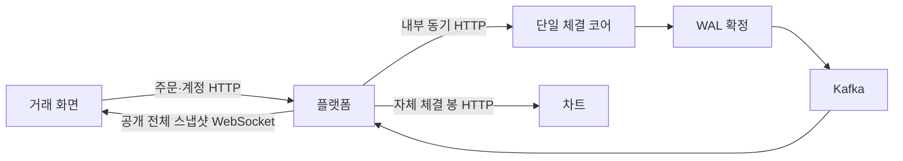

# BTC 거래 화면을 플랫폼의 자체 호가·체결에 연결하기

브라우저의 엔진·바이낸스 직접 호출을 제거하고, 플랫폼을 주문·계정·공개 시세의 진입점으로 사용한다. 자체 거래가 호가창·최근 체결·차트에 나타나는 흐름과 검증 범위를 설명한다.

## 기존 문제

로컬 API 주소는 엔진 3002였지만 사용자 인증·잔액 예약은 플랫폼의 책임이었다. 호가·최근 체결·가격은 각각 바이낸스 SOL 스트림을 구독하고, 차트는 바이낸스 심볼의 외부 위젯이었다. 실제 자체 체결과 화면 데이터의 출처가 달랐다. 지갑 생성 화면은 플랫폼이 제공하지 않는 API를 호출했다.

### 현재 코드로 연결해 읽기

화면에 이미 적용한 순번보다 오래된 같은 엔진의 스냅샷은 되돌리지 않는다. 아래는 2026-10-27 현재 [실제 소스](../../apps/exchange/src/lib/market.ts#L18)의 연속 행 발췌다. 메서드 일부일 수 있으므로 독립 실행 예제로 사용하지 않고 앞뒤 검증과 함께 읽는다. 과거 사이클의 코드/측정 시점은 본문의 기록을 유지한다.

```typescript
  if(current && current.book.engine_id===next.book.engine_id && BigInt(next.book.sequence)<=BigInt(current.book.sequence)) return current;
  return next;
}
```

`BigInt`는 문자열 순번을 JavaScript Number의 정밀도 손실 없이 비교한다. 이 블록 앞에서 거래쌍·호가·체결 필드를 검증한다. 새 화면 기능을 추가한 작업이 아니라 기존 코드를 문서에 옮긴 것이다.

## 검증된 접근과 선택

- [Coinbase 공개 시세 피드](https://help.coinbase.com/en/developer-platform/websocket-feeds/exchange)의 스냅샷·후속 갱신 역할을 참고했다. 이번 공개 스트림은 메시지마다 상위 20개 전체 스냅샷을 제공한다. 델타보다 전송량이 크지만 최초 조회·재연결·중간 프레임 누락에서 병합 경합이 없다.
- 플랫폼 HTTP와 공개 WebSocket만 호출한다. 개발은 `http://localhost:8080`, 배포는 같은 출처의 `/api`·`/ws`를 플랫폼으로 연결한다. 엔진 주소를 브라우저 설정으로 제공하지 않는다.
- [Lightweight Charts](https://tradingview.github.io/lightweight-charts/docs/5.0)의 설치된 타입과 공식 시리즈 API를 확인했다. 기존 Next·React에는 자체 OHLC 캔들 렌더러가 없으므로 5.2.1을 설치했다. 외부 위젯의 지표·도구 전체 대신 실제 자체 체결 봉을 그린다. 라이브러리의 출처 표시를 유지한다.
- 입력 비율·예상 대금에는 `decimal.js` 10.6.0을 사용한다. 직접 십진 계산기를 만들지 않는다. 캔버스 좌표로 바꾸는 숫자는 표시용이며 주문·잔액의 권위가 아니다.
- 기존 ESLint 9 명령에는 설정이 없었다. 설치된 Next 공식 규칙을 사용하도록 설정했다. 브라우저 검증에는 Playwright를 설치하고 기존 Chrome을 사용한다.

## 구현과 데이터 흐름



- [시장 컨텍스트](../../apps/exchange/src/contexts/MarketContext.tsx)는 화면 전체에서 소켓 하나를 공유한다. 1초 뒤 재연결하고, 30초 동안 심박이 없으면 닫아 전체 상태를 다시 받는다.
- [스냅샷 검사](../../apps/exchange/src/lib/market.ts)는 잘못된 거래쌍·금액 구조를 거부한다. 문자열 순번은 `BigInt`로 비교해 같은 엔진의 중복·역순 프레임이 화면을 되돌리지 못하게 한다.
- [호가창](../../apps/exchange/src/components/OrderBook.tsx)·[최근 체결](../../apps/exchange/src/components/TradeHistory.tsx)은 자체 데이터만 표시한다. 호가나 체결이 없으면 빈 상태를 표시한다.
- [차트](../../apps/exchange/src/components/MarketChart.tsx)는 플랫폼의 최근 5천 체결 기반 1분 봉을 받는다. 같은 과거 봉은 유지하고 마지막 봉·새 봉만 갱신하며, 조회 범위가 바뀌면 전체를 재동기화한다. 맨 앞 봉은 해당 조회 범위 안의 체결 기준이라는 한계가 있다.
- [API 클라이언트](../../apps/exchange/src/lib/api.ts)는 플랫폼의 카멜 표기·배열·페이지 응답을 직접 사용한다. 금액과 주문 식별자는 문자열이다. 플랫폼이 제공하지 않는 지갑 API·프록시와 이전 외부 위젯을 삭제했다.
- 계정 화면은 거래소 잔액을 표시한다. BTC 온체인 입출금·수탁 구현을 의미하지 않는다. 기존 금융 기록이나 SOL WAL은 변경하지 않았다.

## 주문 접수와 결과 불명

[주문 패널](../../apps/exchange/src/components/OrderPanel.tsx)은 새 의도에 UUID를 한 번 부여하고, 전송 전에 사용자별 세션 저장소에 키·원본을 남긴다. 새로고침 뒤에도 동일 키·본문으로 조회한다. 명시적인 입력·인증 거부는 수정할 수 있지만 통신 실패·서버 오류를 새 키의 주문으로 바꾸지 않는다.

| 응답 | 화면의 의미 |
| --- | --- |
| 201 | 엔진 WAL 접수 확인. 체결 완료는 아님 |
| 200 | 기존 플랫폼 접수 조회. 이 요청이 엔진을 재전송한 것은 아님 |
| 202 | 플랫폼 저장 완료, 엔진 접수 결과 불명 |
| 취소 202 | 엔진 취소 확인. 주문 상태·잔액은 Kafka 반영을 기다림 |

원본 보존은 중복 생성을 막는 대신 확인 절차가 필요하다. 브라우저 저장소 삭제·다른 기기까지 의도를 자동 연결하는 기능은 없다. 금융 정산 완료는 거래내역에서 확인해야 한다.

## 작성한 테스트와 결과

2026-10-21, Node 22.22.3·기존 Chrome, 실제 로컬 3003·8080 서비스를 호출하지 않고 실행했다.

[계약 테스트](../../tests/contracts.test.ts), `npm test`: **11개 통과**.

- 카멜 표기 로그인 토큰과 배열·페이지 응답.
- 큰 ID 문자열 유지, 신규 접수·기존 접수·결과 불명 구분.
- 동일 키·본문 유지, 인증 갱신 뒤 동일 키 유지, 통신 실패의 자동 재제출 금지.
- HTTP 거부 구분, 큰 순번의 중복·역순·누락·엔진 변경 처리.
- 다른 시장 거부, 플랫폼 소켓 주소, 분리한 인증 구독 함수의 호출 안전성.

[브라우저 테스트](../../e2e/exchange.spec.ts), `npm run test:e2e`: **3개 통과**.

1. 자체 호가·체결, 역순 무시와 재연결 후 전체 스냅샷.
2. 202 응답 뒤 새로고침해도 같은 키·본문으로 확인, 주문 입력 잠금.
3. 자체 캔들 차트 렌더링과 바이낸스·외부 위젯 요청 부재.

브라우저는 격리된 Next 포트 3103과 별도 빌드 경로를 사용한다. API·소켓은 예약 도메인 `platform.invalid`에서 가로채므로 기존 플랫폼으로 빠지지 않는다. 실제 Rust·Java·Kafka의 검증은 [플랫폼 전체 경로 기록](../../../Cex-Platform-Service/docs/decisions/007-platform-market-gateway.md)을 참고한다.

`npm run lint`, `npx tsc --noEmit`, `NEXT_DIST_DIR=.next-market-build npm run build`도 통과했다. 성능·인증 보안 심사·모바일 전체 화면·장시간 대량 연결 검증은 수행하지 않았다. Next 의존성 보안 갱신은 별도 기록으로 관리한다.

## 관련 구현 커밋

- [프론트 연결·계약·브라우저 검증](https://github.com/GiHoon1123/Cex-Frontend/commit/89e72dc)
- [엔진 시장 출력](https://github.com/GiHoon1123/Cex-Engine/commit/92561a3)
- [플랫폼 공개 시세·봇·취소 경계](https://github.com/GiHoon1123/Cex-Platform-Service/commit/d6bbe17)

후속 보안 갱신에서는 개인 주문 조회·큰 ID 취소 검증을 추가했다. 현재 누적 브라우저 검증 4개와 최신 의존성 결과는 [보안 갱신 기록](002-next-security-update.md)을 따른다.
